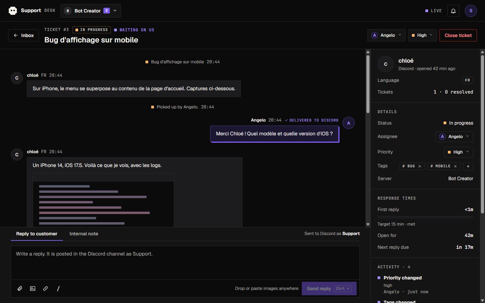
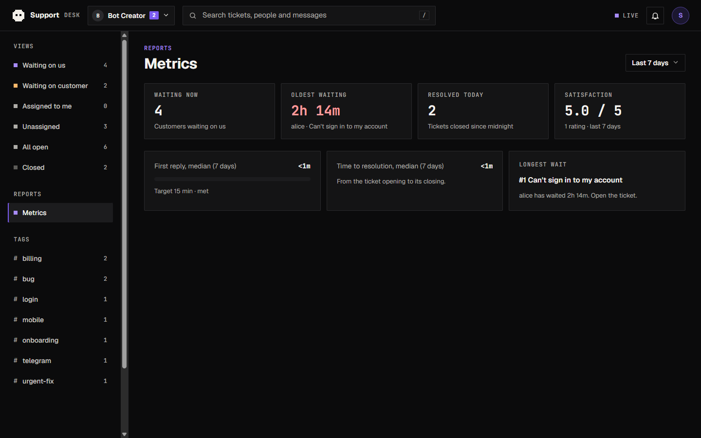
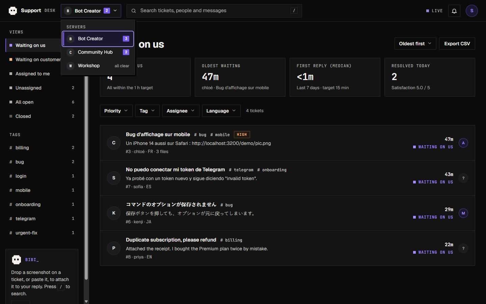

# Bot Discord de support par tickets

Un bot Discord qui transforme chaque demande en **ticket privé**, et un **panel web** pour y répondre depuis un seul endroit, sur un ou plusieurs serveurs. Bun, TypeScript, SQLite, aucune base externe.




## Comment ça marche

1. Un admin tape `/setup` dans le salon voulu, avec l'option facultative **`category`** : les salons de support de ce serveur seront créés dans cette catégorie (réglage par serveur, conservé si l'option est omise ; si la catégorie est supprimée, le salon est créé à la racine). Un membre tape ensuite `/ticket` ou clique sur le bouton du message posté par `/setup` (toujours en anglais, avec une bannière). Une fenêtre lui demande un **titre** et une **description détaillée**.
2. Le bot crée un salon privé (visible par l'utilisateur, le bot et le rôle support) et y poste un message d'accueil sous forme d'embed, qui mentionne l'utilisateur.
3. Le support répond depuis le **panel**, avec des fichiers si besoin. Le message apparaît dans le salon sous le pseudo et l'avatar Discord de la personne qui répond (webhook). Répondre directement dans le salon marche aussi : tout est historisé dans le panel, pièces jointes du client comprises (elles sont téléchargées et conservées, car les liens Discord expirent).
4. Le ticket se ferme depuis le panel (ou par `/close`) avec un motif, un message d'adieu optionnel, une demande de note de 1 à 5 et l'envoi de la transcription. Le client ne peut plus écrire. Le ticket peut être rouvert, et son salon supprimé une fois fermé.

## Le panel

L'interface est en anglais et sombre, et suit le design system Bot Creator.

- **Plusieurs serveurs** : un sélecteur en haut ; chaque ticket est rattaché au serveur où il a été ouvert, avec une limite d'un ticket actif par utilisateur et par serveur.
- **Vues** : « Waiting on us » (le client a écrit en dernier, vue d'ouverture), « Waiting on customer », « Assigned to me », « Unassigned », « All open », « Closed », et les tags en barre latérale. Filtres par priorité, tag, responsable et langue ; la recherche porte sur les titres, les personnes et le contenu des messages.
- **Tri et indicateurs** : cartes de compteurs, temps d'attente, export CSV.
- **Statut automatique** : « Open » tant que personne du support n'a répondu, puis « In progress » au nom du premier qui répond (panel ou salon Discord). Fermer, Rouvrir et Supprimer le salon sont manuels.
- **Conversation en plein écran** : chaque ticket a son adresse (`#/t/12`), les brouillons sont conservés par ticket, et un panneau latéral donne le client, les détails, les temps de réponse, l'activité (journal d'audit), les pièces jointes et les tickets précédents. Sous 1100 px, ce panneau devient une feuille « Details ».
- **Équipe** : assignation, priorité, tags, **notes internes** (jamais envoyées à Discord) et **réponses prédéfinies** (tapez `/` dans la zone de réponse, gestion depuis le même menu).
- **Composer** : pièces jointes (10 fichiers, 25 Mo chacun, 40 Mo par envoi ; png, jpg, gif, webp, pdf, txt, log, md, json, csv, zip), glisser-déposer, collage d'images, lien avec aperçu. Un fichier refusé par Discord est signalé par son nom.
- **Métriques** : première réponse et résolution (médianes), attente la plus longue, satisfaction, sur 7, 30 ou 90 jours.
- **Transcription** : bouton de téléchargement (`.txt`, messages publics seulement, sans notes internes).
- **Clavier** : `/` recherche, `j` et `k` pour se déplacer, Entrée pour ouvrir, `r` répondre, `n` note interne, `c` fermer, Échap, `?` pour la liste.
- **Temps réel** (Server-Sent Events) et notifications du navigateur (la cloche).
- **Connexion Discord (OAuth2)** ou simple mot de passe. Les super-admins voient tous les serveurs du bot ; les autres voient ceux où ils ont « Gérer le serveur ».





## Côté utilisateur : 13 langues

La langue par défaut est l'**anglais**. Le français n'apparaît que pour un client dont la langue est le français. Tout ce que voit **une personne** sur Discord est dans sa langue (`interaction.locale`) : message d'accueil, fenêtre de création, descriptions des commandes slash, erreurs, confirmations, messages de fermeture et de réouverture, boutons de note. La langue est mémorisée sur le ticket, donc les messages postés depuis le panel la suivent aussi. Seul le message public de `/setup` ne suit pas la langue : il est toujours en anglais.

Langues : anglais (par défaut), français, espagnol, allemand, portugais, italien, néerlandais, polonais, russe, turc, japonais, coréen, chinois. Les textes par langue sont dans `src/i18n.ts` ; tout le reste (panel, notes système, erreurs d'API, journaux) est en anglais, et `tests/english-default.test.ts` échoue si du français réapparaît hors de ce fichier.

Le support se fait **en anglais** : hors anglais, l'accueil le précise.

## Démarrage

```bash
bun install
cp .env.example .env     # renseigner DISCORD_TOKEN et TEST_GUILD_ID
bun run start            # bot + panel sur http://localhost:3000
```

Le bot demande l'intent privilégié **Message Content** (portail développeur Discord) pour historiser les messages.

| Variable | Rôle |
|---|---|
| `DISCORD_TOKEN` | Token du bot (requis) |
| `TEST_GUILD_ID` | Serveur de test : en dev, les commandes ne sont enregistrées **que** là (requis hors production) |
| `NODE_ENV=production` | Commandes enregistrées globalement ; le bot sert tous les serveurs où il est invité |
| `OAUTH_CLIENT_SECRET` | Active la connexion au panel via Discord. Vide = mot de passe |
| `PUBLIC_URL` | Adresse du panel (défaut `http://localhost:PORT`) ; la redirection OAuth2 est `PUBLIC_URL/auth/callback` |
| `ADMIN_IDS` | Super-admins (tous les serveurs), IDs séparés par des virgules (vide = propriétaire de l'application) |
| `PANEL_PASSWORD` | Mode sans OAuth : mot de passe du panel (généré et affiché au démarrage si absent) |
| `SUPPORT_ROLE_ID` | Optionnel : rôle staff qui voit les tickets |
| `TICKET_CATEGORY_ID` | Optionnel : catégorie par défaut, utilisée tant qu'un serveur n'a pas choisi la sienne avec `/setup category:` |
| `SESSION_SECRET` | Optionnel : secret de signature des sessions. Absent, il est généré une fois et conservé dans `session-secret` à côté de la base (volume `/data`), donc les connexions survivent aux redémarrages et aux déploiements |
| `ATTACHMENTS_DIR` | Dossier des pièces jointes (défaut : `attachments` à côté de la base ; `/data/attachments` dans Docker) |

### Connexion Discord (OAuth2)

1. Portail développeur Discord, application du bot, onglet **OAuth2** : copier le *Client Secret* dans `OAUTH_CLIENT_SECRET`.
2. Dans *Redirects*, ajouter exactement `PUBLIC_URL/auth/callback` (ex. `http://localhost:3000/auth/callback`).
3. Les réponses sont signées du pseudo Discord de la personne connectée.

## Docker

L'image est construite et publiée à chaque push par GitHub Actions (tests puis build `amd64` + `arm64`) :

```bash
docker pull ghcr.io/delikesance/bot-creator-support:latest
docker run -d --env-file .env -p 3000:3000 -v tickets-data:/data ghcr.io/delikesance/bot-creator-support:latest
```

Ou en local avec Compose (volume `tickets-data` pour la base SQLite) :

```bash
docker compose up -d --build
```

### Mise à jour automatique en production

À chaque push sur `master`, la CI publie l'image (`latest` et `sha-<commit>`), puis le job `deploy` se connecte au serveur en SSH et lance `deploy/deploy-support` avec le tag du commit. Le script télécharge l'image, redémarre le bot, attend que son contrôle de santé (`/health`) passe, et **revient à l'image précédente** si ce n'est pas le cas. Les données (`/data`) ne sont pas touchées.

Installation unique sur le serveur :

1. Copier `deploy/deploy-support` dans `/usr/local/bin/` (`chmod 755`).
2. Dans `docker-compose.yml`, utiliser `image: ghcr.io/delikesance/bot-creator-support:${SUPPORT_TAG:-latest}` (le script écrit `SUPPORT_TAG` dans `.env`). Adapter `DIR` et `CONTAINER` en tête du script si le dossier ou le nom du conteneur diffèrent.
3. Créer une clé dédiée (`ssh-keygen -t ed25519`) et ajouter sa partie publique aux `authorized_keys` du serveur avec `restrict,command="/usr/local/bin/deploy-support"` devant : cette clé ne peut rien faire d'autre que déployer.
4. Secrets du dépôt GitHub : `DEPLOY_HOST` (adresse du serveur), `DEPLOY_KEY` (clé privée), `DEPLOY_KNOWN_HOSTS` (ligne du serveur dans `known_hosts`, obtenue avec `ssh-keyscan`).

Déploiement manuel ou retour arrière : `ssh root@serveur sha-1a2b3c4` (n'importe quel tag publié ; sans argument, `latest`).

Derrière un reverse proxy, désactiver la mise en mémoire tampon pour `/api/events` (flux temps réel). Ne jamais mettre `.env` dans l'image : il se passe à l'exécution.

## Tests

```bash
bun test                   # tests unitaires et d'intégration (sans réseau)
bun run lint               # tsc --noEmit
bun run scripts/smoke.ts   # test bout en bout sur le vrai serveur de test (nettoie son salon)
bun run scripts/demo.ts    # panel avec données fictives, sans Discord (mot de passe : demo)
```

`bun run scripts/demo.ts oauth` simule la connexion Discord ; c'est ce mode qui sert aux captures de `docs/`.

## Architecture

`src/tickets.ts` (états + SQLite, recherche, réponses prédéfinies, journal d'audit) et `src/metrics.ts` → `src/desk.ts` (logique métier, interface `Gateway` vers Discord) → `src/bot/` (interactions, webhooks, embeds, téléchargement des pièces jointes) et `src/web.ts` (API + auth + flux temps réel + fichiers statiques de `public/`). `src/storage.ts` stocke et valide les pièces jointes, `src/unfurl.ts` fabrique les aperçus de lien (protégé contre le SSRF), `src/i18n.ts` contient les textes par langue. Le panel est dans `public/` (`index.html`, `app.css`, `app.js`, `composer.js`, `lib.js`, sans dépendance). `assets/embed/` contient la bannière et Bibi. L'API est décrite dans `docs/api-contract.md`.

## Limites connues

- Les envois de fichiers, les embeds avec images jointes, les boutons de note et la transcription n'ont pas été essayés contre un vrai serveur Discord (les tests n'ont pas de réseau).
- L'aperçu de lien reste exposé au « DNS rebinding » entre la vérification et la connexion ; il est réservé au personnel connecté et ne renvoie que des métadonnées.
- Il n'y a pas de thème clair (le design est sombre uniquement) ni de progression d'envoi par fichier.
