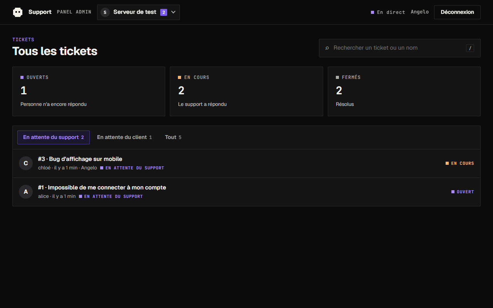

# Bot Discord de support par tickets (Bun)

Les utilisateurs ouvrent un ticket depuis Discord (`/ticket` ou bouton du panneau `/setup`) : le bot crée un salon privé.
L'administrateur gère tout depuis le **panel web** (statuts 🟢 Ouvert / 🟡 En cours / 🔴 Fermé, réponses postées dans le salon, fermeture, réouverture, suppression du salon).



## Démarrage

```bash
bun install
cp .env.example .env     # renseigner DISCORD_TOKEN et TEST_GUILD_ID
bun run start            # bot + panel sur http://localhost:3000
```

| Variable | Rôle |
|---|---|
| `DISCORD_TOKEN` | Token du bot (requis) |
| `TEST_GUILD_ID` | Serveur de test : en dev, les commandes ne sont enregistrées **que** là (requis hors production) |
| `NODE_ENV=production` | Commandes enregistrées globalement ; le bot peut servir plusieurs serveurs, chaque ticket est créé sur le serveur où il est ouvert |
| `OAUTH_CLIENT_SECRET` | Active la connexion au panel via Discord (OAuth2). Vide = mot de passe |
| `PUBLIC_URL` | Adresse du panel (défaut `http://localhost:PORT`) ; la redirection OAuth2 est `PUBLIC_URL/auth/callback` |
| `ADMIN_IDS` | Super-admins (tous les serveurs), IDs séparés par des virgules (vide = propriétaire de l'application) |
| `PANEL_PASSWORD` | Mode sans OAuth : mot de passe du panel (généré et affiché au démarrage si absent) |
| `SUPPORT_ROLE_ID`, `TICKET_CATEGORY_ID` | Optionnels : rôle staff et catégorie des salons |

Le bot demande l'intent privilégié **Message Content** (portail développeur Discord) pour historiser les messages.

## Connexion Discord (OAuth2)

1. Portail développeur Discord, application du bot, onglet **OAuth2** : copier le *Client Secret* dans `OAUTH_CLIENT_SECRET`.
2. Dans *Redirects*, ajouter exactement `PUBLIC_URL/auth/callback` (ex. `http://localhost:3000/auth/callback`).
3. Les super-admins (`ADMIN_IDS` ou propriétaire de l'application) voient tous les serveurs du bot ; les autres voient uniquement ceux où ils ont « Gérer le serveur » (sélecteur en haut du panel) ; leurs réponses sont signées de leur pseudo Discord.

## Docker

```bash
docker compose up -d --build   # volume `tickets-data` pour la base SQLite
```

## Tests (TDD)

```bash
bun test          # tests unitaires et d'intégration (sans réseau)
bun run lint      # tsc --noEmit
bun run scripts/smoke.ts   # test bout en bout sur le vrai serveur de test (nettoie son salon)
bun run scripts/demo.ts    # panel avec données fictives, sans Discord
```

## Architecture

`src/tickets.ts` (états + SQLite) → `src/desk.ts` (logique métier, interface `Gateway` vers Discord) → `src/bot/` (interactions) et `src/web.ts` (API + auth) ; `public/index.html` est le panel.

## Temps réel et formulaire

- Le panel reçoit les messages et changements de statut en direct (Server-Sent Events, `/api/events?guild=…`), avec un rafraîchissement de secours toutes les 30 s. Derrière un reverse proxy, désactiver la mise en mémoire tampon pour `/api/events`.
- La modale Discord demande un **titre** (100 car. max) et une **description détaillée** (20 à 1000 car.), reprise dans le salon et l'historique du ticket.
- Chaque ticket actif indique **qui doit répondre** : « en attente du support » (le client a écrit en dernier) ou « en attente du client » (le support a répondu). C'est calculé automatiquement d'après le dernier message, les notes système sont ignorées. Deux filtres avec compteurs dans la liste.
- **Pas de prise en charge manuelle** : un ticket est « Ouvert » tant que personne du support n'a répondu, puis passe automatiquement « En cours » au nom du premier qui répond (depuis le panel ou directement dans le salon). Seuls Fermer, Rouvrir et Supprimer le salon sont des actions manuelles.
- Un ticket s'ouvre en **plein écran** (adresse `#/t/12`, le bouton « précédent » du navigateur et le rechargement fonctionnent) ; Échap ou « ← Tickets » revient à la liste.
- Le panel trie par défaut sur **En attente du support** ; les onglets « En attente du client » et « Tout » sont à côté, et les cartes de compteurs filtrent par statut.
- Tout ce que voit l'utilisateur sur Discord est traduit selon sa langue (`interaction.locale`, 13 langues, anglais par défaut, textes dans `src/i18n.ts`) : message d'accueil, modale, panneau `/setup`, descriptions des commandes slash, erreurs, confirmations, messages de fermeture et de réouverture (la langue est mémorisée sur le ticket). Hors anglais, l'accueil prévient que le support se fait en anglais et qu'une solution sera trouvée si l'utilisateur n'est pas à l'aise. Le panel admin reste en français.
